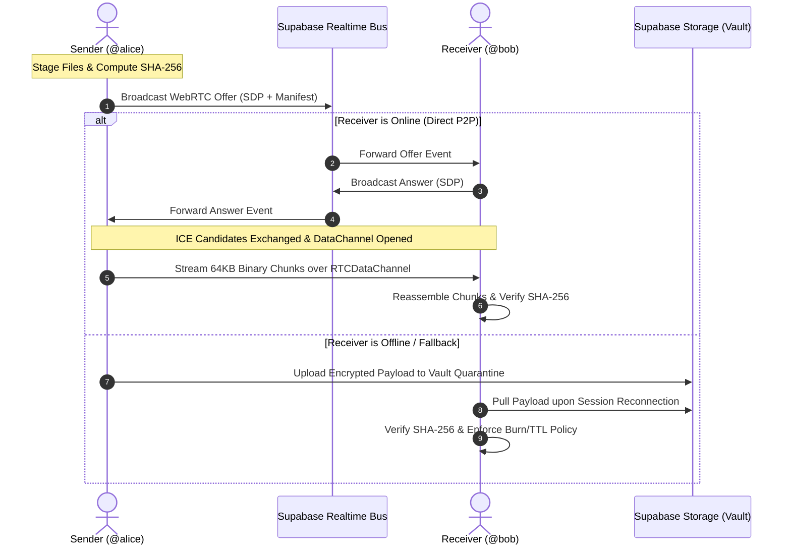

# ⚡ BEAM

<div align="center">

**Frictionless Peer-to-Peer File Transit to Any @Username**

*End-to-End Encrypted • Zero Links • Sub-Second Mesh Routing*

[-black?style=for-the-badge&logo=next.js)](https://nextjs.org/)
[](https://www.typescriptlang.org/)
[](https://webrtc.org/)
[](https://supabase.com/)
[](https://tailwindcss.com/)
[](LICENSE)

</div>

---

## 📖 Overview

Traditional file transfer services force you into a broken loop: upload your files to third-party cloud storage, wait for processing, copy an unauthenticated sharing link, and email or message it to your recipient.

**BEAM replaces links with cryptographic username handles.** 

Enter a recipient's `@username`, stage any payload, and beam it directly from your browser to theirs over an encrypted **WebRTC `RTCDataChannel`**. Zero intermediaries, zero public URLs, and bit-exact data integrity guaranteed by browser-native SHA-256 validation.

---

## ✨ Key Features

- **🚀 Direct WebRTC Binary Transit**
  Streams gigabyte-scale files directly peer-to-peer using 64 KB chunk framing and backpressure flow control (`bufferedAmountLowThreshold`), bypassing cloud bandwidth bottlenecks.

- **🏷️ Cryptographic Handle Identity (`@username`)**
  Personal routing addresses registered with live debounced availability checks, backed by PBKDF2 / SHA-256 salted passphrase verification in Supabase.

- **📡 Realtime Signaling Mesh**
  Uses Supabase Realtime Broadcast channels (`beam_signal_<handle>`) for SDP offers, answers, and ICE candidate negotiation with zero need for custom WebSocket infrastructure.

- **🛡️ Bit-Exact SHA-256 Data Integrity**
  Every staged file computes a 64-character hexadecimal SHA-256 digest in-browser. The receiving node calculates the checksum of the assembled payload before download, verifying identical byte integrity.

- **🔒 Advanced Transport Policies**
  - **Self-Destruct TTL:** Configurable expiration windows (1h to 72h).
  - **Burn on Download:** Automatically purges payload data immediately after the first successful receipt.
  - **Passkey Lock:** Mandates the sender's secret passphrase before decrypting and releasing files.
  - **Access Capping:** Restricts repeat pulls to 1x, 3x, or custom allowances.

- **📦 Resilient Fallback Vault**
  If a recipient is temporarily offline when a beam is dispatched, payloads safely quarantine in Supabase Storage (`beam-payloads`) with identical security and download policies.

- **📊 Live Routing Telemetry & HUD**
  Sub-second speedometers, real-time throughput metrics (MB/s), live progress gauges, and peer presence heartbeats.

---

## 🏗️ Architecture & Transit Flow



---

## 🛠️ Tech Stack

| Layer | Technology | Purpose |
| :--- | :--- | :--- |
| **Framework** | [Next.js 16.4.5](https://nextjs.org/) | React 19 App Router with Turbopack compilation |
| **Language** | [TypeScript 5.7](https://www.typescriptlang.org/) | Strict type safety and manifest schema enforcement |
| **P2P Transit** | [WebRTC](https://webrtc.org/) | `RTCDataChannel` direct browser-to-browser streaming |
| **Backend & DB** | [Supabase](https://supabase.com/) | PostgreSQL, Realtime WebSocket Broadcast, and RLS |
| **Cloud Storage** | Supabase Storage | Encrypted fallback vault bucket (`beam-payloads`) |
| **State Sync** | React `useSyncExternalStore` | Singleton state manager with zero tearing |
| **Styling** | [Tailwind CSS 3.4](https://tailwindcss.com/) | Responsive dark-mode HUD theme |
| **Icons** | [Lucide React](https://lucide.dev/) | Clean vector iconography |

---

## 🚀 Getting Started

### Prerequisites

- **Node.js** >= 18.18.0
- **pnpm** >= 9.0.0 (or `npm` / `yarn`)
- A **Supabase** account and project

### 1. Clone the Repository

```bash
git clone https://github.com/HaxOrWot/BEAM.git
cd BEAM
```

### 2. Install Dependencies

```bash
pnpm install
```

### 3. Configure Environment Variables

Create a `.env.local` file in the project root:

```env
NEXT_PUBLIC_SUPABASE_URL=https://your-project-ref.supabase.co
NEXT_PUBLIC_SUPABASE_ANON_KEY=your-anon-key
SUPABASE_SERVICE_ROLE_KEY=your-service-role-key
```

### 4. Database Setup

Apply the database schema in [`supabase_schema.sql`](./supabase_schema.sql) to your Supabase project (via SQL Editor or CLI):

```bash
# Using Supabase CLI:
supabase db query --file supabase_schema.sql
```

Ensure the `beam-payloads` storage bucket is created with public read/write access:

```sql
insert into storage.buckets (id, name, public, file_size_limit, allowed_mime_types)
values ('beam-payloads', 'beam-payloads', true, 524288000, null)
on conflict (id) do nothing;
```

### 5. Run the Application

#### Development Mode (with Turbopack)
```bash
pnpm dev
```
Open [http://localhost:3000](http://localhost:3000) in your browser.

#### Production Build & Start
```bash
pnpm build
pnpm start
```

---

## 📁 Project Structure

```text
BEAM/
├── public/                 # Static assets and icons
├── src/
│   ├── app/
│   │   ├── dashboard/      # Protected Transfer Station & Activity Deck
│   │   ├── login/          # Cryptographic handle sign-in
│   │   ├── signup/         # @username claim & entropy passphrase setup
│   │   ├── globals.css     # Dark mode HUD tokens & custom animations
│   │   └── layout.tsx      # Root HTML layout & Bitdefender sanitizer
│   ├── components/
│   │   ├── auth/           # SignInCard, SignUpCard
│   │   ├── dashboard/      # TransferStation, ActivityDeck, StatusHeader, Telemetry
│   │   ├── landing/        # HeroSection, FeaturesSection, ComparisonSection, CTA
│   │   ├── layout/         # Navbar, Footer
│   │   └── logo/           # Minimalist vector SVG logo
│   └── lib/
│       ├── p2p/            # BeamP2PEngine (WebRTC) & P2PProvider context
│       ├── store.ts        # Singleton useSyncExternalStore state & Realtime sync
│       ├── supabase.ts     # Supabase client, queries, and cryptographic auth
│       ├── types.ts        # TypeScript definitions for files, accounts, and transfers
│       └── utils.ts        # SHA-256 checksums, byte formatting, and timers
├── supabase_schema.sql     # PostgreSQL database schema & RLS policies
└── package.json            # Project manifest & scripts
```

---

## 🔐 Security & Integrity Specification

- **Zero Link Leakage:** Payloads are addressed to node identities rather than public URLs, preventing token scraping or crawler leaks.
- **Passphrase Salting:** Passphrases are hashed with the user handle via Web Crypto API PBKDF2/SHA-256 before verification.
- **Bit-Exact Verification:** Files verify checksum equality (`expectedHash === computedHash`) upon assembly before presenting the download button.
- **Auto-Burn Quarantine:** Transferred files configured with *Burn on Download* are automatically deleted from storage once pulled.

---

## 📄 License

This project is open-source under the [MIT License](LICENSE).
